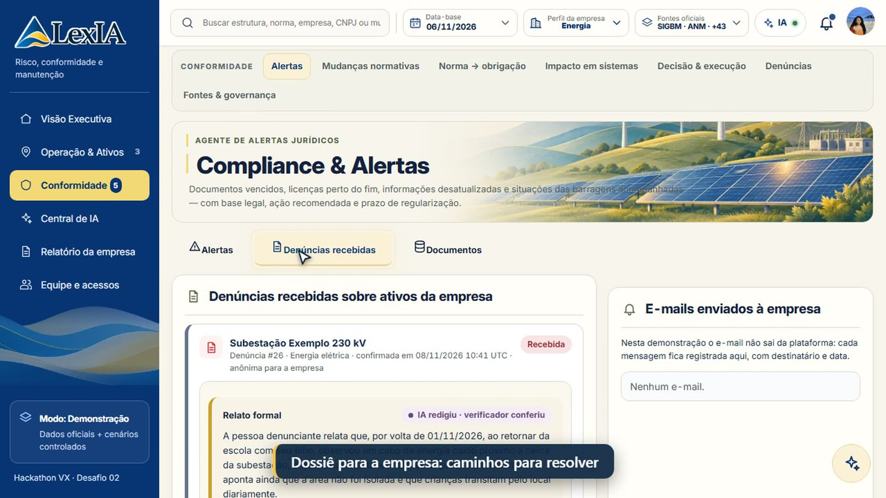
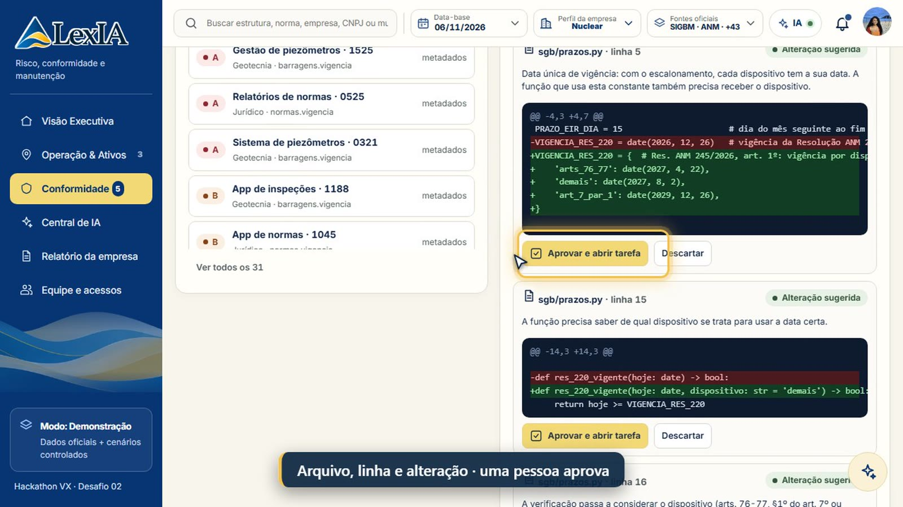
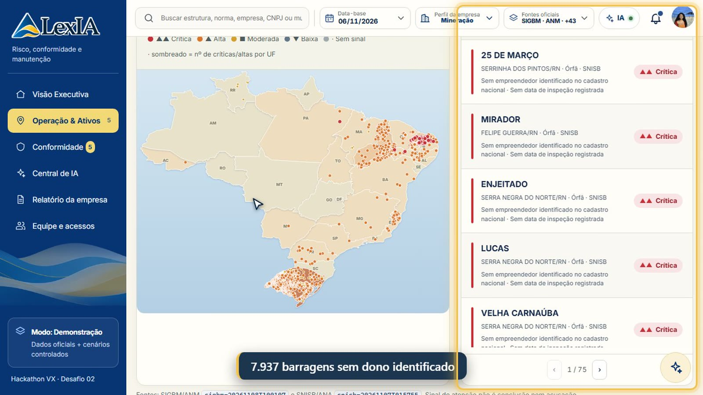
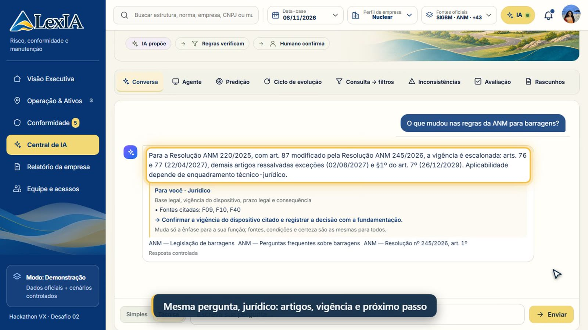

<p align="center"></p>

<h3 align="center">Da mudança regulatória à decisão executável</h3>
<p align="center">Risco, conformidade e manutenção para mineração, energia, saneamento e nuclear · Hackathon VX · Desafio 02</p>

---

# ▶ COMO TESTAR A PLATAFORMA

## 🎬 Assista primeiro: o vídeo que mostra como usar (3 min 48 s)

### **[▶ ABRIR O VÍDEO — docs/video/LexIA_demo.mp4](docs/video/LexIA_demo.mp4)**

Se o player não abrir no navegador, use o link direto: [baixar o vídeo (MP4, 47 MB)](https://github.com/vaz-123ale/LexIA-Hackathon-VX/raw/main/docs/video/LexIA_demo.mp4).
O roteiro com o tempo de cada cena e onde clicar está em [docs/video/ROTEIRO.md](docs/video/ROTEIRO.md). Há também um [vídeo de 40 s](docs/video/LexIA_40s.mp4), sem áudio.

## 1 · Rodar (2 minutos)

Precisa só do **Python 3.10 ou mais novo** (testado no 3.12). Nenhum pacote é obrigatório e não precisa de internet para a demonstração.

```bash
git clone https://github.com/vaz-123ale/LexIA-Hackathon-VX.git
cd LexIA-Hackathon-VX
python -m app.server            # Linux/Mac: python3 -m app.server
```

Abra **http://localhost:8765**

No Windows, também dá para clicar duas vezes em `iniciar_windows.bat`; no Linux/Mac, rode `./iniciar_linux_mac.sh`.

## 2 · Entrar

Na tela **Entrar**, use o cartão **Acesso rápido**: um clique e você está dentro.

| Conta | E-mail | Senha |
|---|---|---|
| Cidadão | `joana@demo.lexia.app` | `LexIA2026demo` |
| Empresa (jurídico) | `ana@demo.lexia.app` | `LexIA2026demo` |
| Equipe LexIA (curadoria) | `gabi@demo.lexia.app` | `LexIA2026demo` |

Para a **denúncia anônima**, não precisa de conta: use o menu do site.

## 3 · Roteiro de teste (10 passos)

| # | Onde | O que fazer | O que observar |
|---|---|---|---|
| 1 | Site → **Denúncia anônima** | Escolha **Energia elétrica**, clique em **Usar local de exemplo** e toque num número do mapa | O número oficial da estrutura, o responsável e a imagem de satélite |
| 2 | Mesma tela | Escolha o ativo dourado, conte o caso como uma história e clique em **Gerar denúncia** | O relato formal, as normas possivelmente descumpridas e a faixa de multa, com a base legal |
| 3 | Mesma tela | Clique em **Revisei, enviar denúncia** | O código `LX-…` para acompanhar, sem nenhum dado pessoal |
| 4 | Entrar → **Empresa** → **Perfil** (topo) → **Energia** | Vá em **Conformidade → Denúncias recebidas** | O dossiê com o checklist de caminhos. Marque um passo |
| 5 | Mesma tela | Clique em **Não é da minha área: repassar** → Engenharia | A triagem: a área é avisada e fica na trilha |
| 6 | **Conformidade → Impacto em sistemas** | Escolha a mudança da Resolução ANM 220 e clique em **SGB · Inspeções** | Os sistemas afetados e o arquivo, a linha e o diff do código. Aprove, e vira tarefa |
| 7 | **Conformidade → Norma → obrigação** | Clique em **Extrair obrigações** | As obrigações presas ao trecho literal. Confirme uma |
| 8 | **Operação & Ativos** (perfil Mineração) → **Barragens de mineração** | Clique em **Órfãs · SNISB** | Os radares com dados reais: 7.937 barragens sem dono identificado |
| 9 | **Central de IA** → **Técnica** | Pergunte "O que mudou nas regras da ANM para barragens?" e compare com a resposta da conta cidadão | A mesma fonte e a mesma certeza, em linguagem diferente |
| 10 | **Equipe e acessos** | Dê acesso a um e-mail e desmarque uma área no checklist | O acesso por frente e por módulo, que vale na hora |

> Trocar o **Perfil da empresa** no topo muda módulos, normas, alertas e notificações: mineração, energia, saneamento e nuclear usam o mesmo núcleo.

---

## O que a LexIA oferece

| | |
|---|---|
| **Mudança regulatória por dispositivo** | Vigência calculada artigo por artigo, com a data-base escolhida pelo usuário |
| **Ativos e radares com dados oficiais** | Barragens (ANM/SIGBM e ANA/SNISB), minas e fechamento (SIGMINE), usinas e outorgas (ANEEL/SIGA), reservatórios (ONS), instalações radiológicas |
| **Alerta para a pessoa certa** | Base legal, prazo e responsável por papel; escalado quando o papel está vazio |
| **Denúncia que vira dossiê** | Com conta ou anônima: mapa com número oficial, relato formal, normas, faixa de multa e checklist de caminhos para a empresa |
| **Triagem entre áreas** | Repasse de alerta, norma, denúncia ou sistema para a função certa, com aviso e trilha |
| **Norma → obrigação → sistema → código** | Obrigações extraídas do texto; impacto no portfólio de aplicações até o arquivo e a linha |
| **Equipe e acessos** | Convite por e-mail ou por planilha/PDF; checklist por módulo; revogação imediata; acesso preso à frente |
| **Prova e auditoria** | Decisão humana registrada, evidência com hash, relatório da empresa em PDF |
| **Portal do cidadão e Transparência** | Linguagem simples, barragens da região, quantas denúncias foram feitas e respondidas |

<p align="center"> </p>
<p align="center"> </p>

## Onde a IA está — e onde não está

**A regra do produto: a IA propõe, regras versionadas verificam e uma pessoa decide.**

| A IA entra aqui (com verificador) | Aqui é regra versionada (sem IA) |
|---|---|
| Transformar a história do cidadão em relato formal (recusa número, data ou nome que não esteja no relato) | Vigência por dispositivo |
| Responder perguntas sobre normas, só com citação; sem base, se abstém | Radares de risco e níveis de atenção |
| Linguagem por perfil (simples para o cidadão, técnica para o jurídico), com as mesmas fontes | Quais normas se aplicam ao setor e ao tipo de ativo |
| Propor obrigações a partir do texto da norma, presas ao trecho literal | Faixas de multa (texto legal, com fonte) |
| Sugerir pontos de código afetados, só aceitos se o trecho existir no arquivo | Roteamento de alertas, triagem, permissões e checklist do dossiê |
| Filtro em português ("inativas sem projeto em MG") | Cruzamento do portfólio de sistemas e diffs dos detectores |

De 60 a 83% das consultas são resolvidas sem chamar IA paga (regras e cache), com teto diário. A avaliação da IA (65 casos, 100% de acerto) fica aberta em **Central de IA → Avaliação**.

## O que é real e o que é simulado

- **Real (dados oficiais públicos):** ANM (SIGBM: 902 barragens; SIGMINE: 18.899 títulos), ANA (SNISB: 7.937 barragens sem dono identificado, além das de energia e abastecimento), ANEEL (SIGA: 25.046 usinas), ONS (175 reservatórios) e 45 fontes normativas catalogadas. Os dados estão em `data/snapshots/`, com data e hash.
- **Simulado (marcado em cada tela):** as empresas de demonstração, os ativos, as leituras de sensores, o portfólio de 2.140 aplicações e os repositórios de código de exemplo.
- **Não é parecer jurídico** nem certificação: é avaliação preliminar para apoiar uma decisão humana.

## Arquitetura e AWS

- **Servidor:** Python (biblioteca padrão) com SQLite. **Interface:** JavaScript sem build, instalável como aplicativo (PWA).
- **Normas:** busca local (BM25) no catálogo curado, filtrada por setor e vigência, antes de qualquer IA.
- **IA generativa:** opcional e plugável. Na demonstração usamos o Google Gemini. O caminho de implantação já está no código ([app/cloud_aws.py](app/cloud_aws.py)):
  - **Amazon Bedrock** para a IA, na conta do cliente;
  - **S3 com Object Lock** como cofre de provas imutável;
  - **SES** para os e-mails de denúncia e convite.
- **Ligar a IA generativa:** copie `.env.example` para `.env` e preencha uma chave. Sem chave, tudo funciona em modo controlado.

## Estrutura do repositório

```
app/                 servidor, regras, radares, IA e conectores de dados oficiais
web/                 interface (HTML, CSS e JavaScript)
data/                catálogo de normas, setores, empresas fictícias e snapshots oficiais
tests/               testes automáticos (python -m unittest discover -s tests)
scripts/             testes de navegador, gravação do vídeo e utilitários
docs/video/          vídeo de demonstração, vídeo de 40 s e roteiros
docs/adr/            decisões de arquitetura
docs/                arquitetura da IA, modelo de dados, proveniência dos dados, guia de uso
infra/aws/           modelo de infraestrutura AWS
```

## Testes

```bash
python -m unittest discover -s tests        # 314 testes
node scripts/e2e_crawl.mjs saida            # varredura de todas as telas no Chrome (servidor rodando)
```

## Documentos

- [Visão geral em 2 páginas (PDF)](docs/LexIA_Visao_Geral.pdf)
- [Arquitetura da IA](docs/ARQUITETURA_IA.md)
- [Proveniência dos dados](docs/DADOS_PROVENIENCIA.md)
- [Modelo de dados e APIs](docs/MODELO_DE_DADOS_E_APIS.md)
- [Guia de uso](docs/GUIA_DE_USO.md)
- [Decisões de arquitetura](docs/adr/)

## Limitações conhecidas

- O Diário Oficial depende de credencial INLABS, e o LexML bloqueia robôs. Os dois aparecem como bloqueados, sem coleta.
- O monitor de fontes detecta que o conteúdo mudou, não interpreta a norma: a curadoria confirma.
- Na demonstração, o e-mail não sai da plataforma e fica registrado na tela. Os conectores Git reais e o SES ligam na implantação.
- A licença de redistribuição do SIGBM ainda precisa ser confirmada.

<p align="center"><sub>LexIA · Hackathon VX 2026 · Desafio 02</sub></p>
